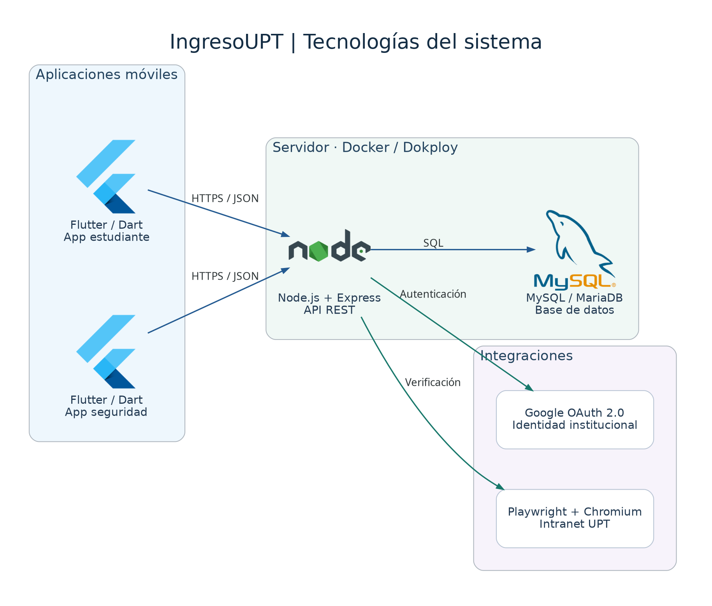

# Tecnologías de IngresoUPT

Diagrama general generado con **Python Diagrams + Graphviz**.



## Tecnologías representadas

- **Aplicaciones móviles:** Flutter y Dart, para estudiante y seguridad.
- **API REST:** Node.js y Express.
- **Base de datos:** MySQL / MariaDB.
- **Despliegue:** Docker y Dokploy.
- **Identidad institucional:** Google OAuth 2.0.
- **Integración con intranet UPT:** Playwright y Chromium.

Las aplicaciones se comunican con la API mediante HTTPS/JSON; la API accede a
la base de datos mediante SQL y consulta los servicios institucionales.

## Generar el diagrama

Desde la raíz del repositorio:

```bash
bash diagramas_arquitectura/generar.sh
```

El script prepara el entorno `.venv/`, instala las dependencias y genera:

- [PNG](salida/arquitectura_completa.png)
- [SVG con iconos incrustados](salida/arquitectura_completa.svg)
- [DOT de Graphviz](salida/arquitectura_completa.dot)

Con el entorno ya preparado, también puedes ejecutar directamente:

```bash
diagramas_arquitectura/.venv/bin/python diagramas_arquitectura/generar_diagramas.py
```

Se utiliza Graphviz del sistema o, en Debian/Ubuntu, una copia local en
`.graphviz/` que el script prepara sin `sudo`. El entorno actual usa Python 3.12.
`.venv/` y `.graphviz/` están excluidos de Git.

Para cambiar el contenido, edita `generar_diagramas.py` y vuelve a ejecutarlo.
La generación no inicia la API ni consulta la base de datos.
